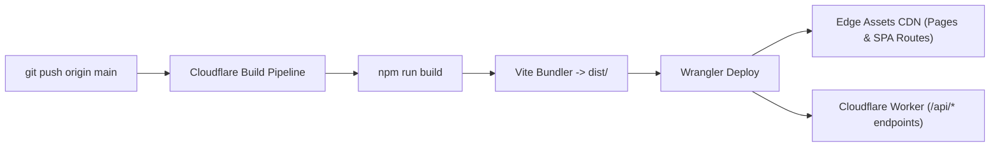

# J/Kopay Christian College Web Portal
### Institutional Web Application & Digital Platform

[](https://react.dev/)
[](https://vitejs.dev/)
[](https://tailwindcss.com/)
[](https://reactrouter.com/)
[](https://workers.cloudflare.com/)
[](LICENSE)

A high-performance, responsive, and bilingual Single Page Application (SPA) built for **J/Kopay Christian College** (Kopay, Jaffna, Sri Lanka). Engineered with modern web standards, hardware-accelerated 3D UI components, in-place offline network resilience, full-page A4 print stylesheet formatting, and Cloudflare edge CDN deployment.

🌐 **Production URL:** [https://jkcc.edu.lk/](https://jkcc.edu.lk/)

---

## 🌟 Application Features & Interactive Modules

### 🔍 Spotlight Command Palette (`Ctrl + K` / `/`)
* **Instant Keyboard Launcher:** Accessible globally via `Ctrl + K` (or `⌘ + K`) or `/` when not focused on an input element.
* **Micro-Staggered Transitions:** Smooth, staggered entry animations for the search input, category filters, and result lists.
* **Indexed Multi-Category Search:** Instant client-side fuzzy searching across pages, event archives, academic records, and contact directories.
* **Full Keyboard Accessibility:** Seamless keyboard navigation (`↑`/`↓` selection, `Enter` navigation, `Esc` dismissal).

### 🃏 3D Perspective Principles Flip Cards
* **Hardware-Accelerated 3D CSS:** Utilizes CSS `perspective`, `transform-style: preserve-3d`, and `backface-visibility: hidden` for 60fps card rotations.
* **Bilingual Flip Trigger:** Flips between English and Tamil content on hover, touch tap, or keyboard navigation (`Enter` / `Space`).
* **Micro-interactions:** Custom depth shadows and smooth easing curves for a tactile glassmorphic feel.

### 🖼️ 3D Coverflow Digital Campus Gallery
* **Perspective 3D Carousel:** Smooth horizontal Coverflow view displaying campus moments, academic sessions, and institutional events.
* **Multi-Input Interaction:** Supports touch swipe gestures, mouse drag, mouse wheel scrolling, navigation arrows, indicator pills, and auto-play rotation.
* **Viewport Triggered Fan-in:** Dynamic 3D fan-in entrance animation triggered via `IntersectionObserver` when entering the viewport.

### 🎵 School Anthem Player & Modal
* **Integrated Audio Player:** Modal-based audio streaming interface with playback controls and progress feedback.
* **Tamil Script Typography:** High-contrast Tamil lyrics set in *Noto Sans Tamil* with a one-click clipboard copy utility.
* **Print Trigger:** Instant action button routing directly to the dedicated single-page print engine.

### 🖨️ A4 Full-Page Ink-Friendly Print Engine
* **Calibrated A4 Dimensions:** Tailored `@media print` rules locking output to a standard **$190\text{mm} \times 270\text{mm}$** printable A4 area with strict single-page boundary enforcement (`overflow: hidden`, `break-inside: avoid`).
* **Certificate-Grade Layout:** Dual collegiate border framing with corner ornaments (`❖`), faint school crest watermark (`opacity: 0.045`), and uniform typography (`text-[13pt] font-medium text-slate-900`) across all 19 verse lines.
* **Ink-Friendly Monochrome/Forest Accents:** Strips heavy backgrounds and glow effects for crisp, eco-friendly printing on home and office printers.

### 📡 Offline Network Resiliency & In-Place Fallback
* **Real-Time Connectivity Monitoring:** Listens to `window.online` and `window.offline` events to provide immediate visual feedback.
* **Non-Intrusive Offline Banners:** Displays a persistent, non-blocking sticky banner when network connectivity is lost, with an auto-dismissing emerald green confirmation banner upon recovery.
* **Network Error Boundary:** Catches dynamic chunk import failures on flaky connections, rendering an in-place `OfflineFallback` with live ping testing (*"Try Again"*) without resetting the user's route history or URL bar.

### 🌐 Dual-Language State Sync & Dynamic SEO
* **Bilingual Route Sync:** History and institutional content toggle seamlessly between English and Tamil (தமிழ்), synchronized via URL query parameters (`?lang=ta`).
* **Dynamic Hreflang Injection:** Dynamically manages `link[rel="alternate"][hreflang]` tags for `en`, `ta`, and `x-default` for search engine indexing.
* **Automated Metadata Management:** Synchronizes `document.title`, `meta[name="description"]`, Open Graph (`og:*`), and Twitter Card tags per view change.

### 🚫 Themed 404 & Broken Link Reporter
* **Branded 404 Interface:** Custom error layout featuring college branding, search shortcuts, and direct navigation links.
* **One-Click Link Reporting:** Pre-filled `mailto:` integration that automatically captures the offending URL, user agent, and timestamp for administrative review.

---

## 🛠️ Technical Architecture & Specifications

### ⚡ Frontend Stack
* **Core Framework:** [React 19](https://react.dev/) (Functional components, custom hooks, Concurrent Rendering).
* **Client-Side Routing:** [React Router v7](https://reactrouter.com/) Single Page Application (SPA) architecture with code-split views (`React.lazy` + `Suspense`).
* **Build Tool:** [Vite 6](https://vitejs.dev/) with Rollup bundler, Hot Module Replacement (HMR), and automated PostCSS pipeline.
* **Styling:** [Tailwind CSS 3.4](https://tailwindcss.com/) with PostCSS and Autoprefixer.
* **Theme Support:** Dark / Light mode adaptive theming with `localStorage` persistence and CSS variable tokens.

### 📦 Bundle Optimization & Performance
* **Manual Chunk Splitting:** Rollup `manualChunks` configured in `vite.config.js` to isolate third-party vendor dependencies (`vendor-react` containing `react`, `react-dom`, and `react-router-dom`) from application logic.
* **Sub-Second First Contentful Paint:** Main application bundle compressed to **~103 kB** (gzipped), ensuring rapid page loads even on mobile 3G/4G networks.
* **Offloaded Media Payloads:** Offloaded all base64 encoded event image strings into static asset directories with progressive WebP/JPG loading.

### ☁️ Edge Infrastructure & Serverless Functions
* **Hosting Platform:** [Cloudflare Workers with Static Assets](https://developers.cloudflare.com/workers/static-assets/) offering global CDN edge caching with zero server maintenance.
* **Serverless Worker (`worker.js`):**
  * **API Dispatchers:** `/api/github` (secure GitHub integration) and `/api/resolve-facebook` (social event sync) with strict CORS and security headers (`X-Robots-Tag: noindex, nofollow, noarchive`).
  * **Edge Asset Routing:** Configured with `binding: "ASSETS"` and `not_found_handling: "single-page-application"` for instant SPA route resolution.
  * **Canonical 301 Redirects:** Normalizes parameterized URLs (`/?lang=...`, `/history?lang=en`) to canonical search engine URLs.
* **Security Headers:** Enforced via `public/_headers` (`Strict-Transport-Security`, `X-Frame-Options: SAMEORIGIN`, `X-Content-Type-Options: nosniff`, `Referrer-Policy: strict-origin-when-cross-origin`).

---

## ⌨️ Global Keyboard Navigation

| Shortcut | Action | Scope |
| :--- | :--- | :--- |
| <kbd>Ctrl</kbd> + <kbd>K</kbd> / <kbd>⌘</kbd> + <kbd>K</kbd> | Open / Close Search Command Palette | Global |
| <kbd>/</kbd> | Open Search Palette (when not in a text field) | Global |
| <kbd>Esc</kbd> | Close active modal (Search, Anthem, Mobile Drawer) | Global |
| <kbd>↑</kbd> / <kbd>↓</kbd> | Navigate search items | Command Palette |
| <kbd>Enter</kbd> | Select search result / Flip 3D Principles card | Search / 3D Cards |
| <kbd>←</kbd> / <kbd>→</kbd> | Previous / Next image slide | 3D Photo Gallery |

---

## 📁 Repository Directory Structure

```text
KCC-Project/
├── public/
│   ├── assets/                     # Campus photography, logos, and event imagery
│   ├── _headers                    # Cloudflare edge security headers (HSTS, CSP, X-Frame)
│   ├── 404.html                    # Fallback redirect for static hosts
│   ├── robots.txt                  # Search engine crawler directives & sitemap location
│   └── sitemap.xml                 # XML Sitemap with Google Image extensions & hreflang
├── src/
│   ├── components/
│   │   ├── AboutDropdown.jsx       # Navigation dropdown for institutional links
│   │   ├── AnthemModal.jsx         # School anthem modal with integrated audio/lyrics
│   │   ├── AnthemPrintSheet.jsx    # Formal A4 full-page certificate print layout
│   │   ├── Contact.jsx             # Contact cards and message inquiry interface
│   │   ├── Footer.jsx              # Footer navigation, contacts, and copyright notices
│   │   ├── Gallery.jsx             # 3D Coverflow photo journal and campus gallery
│   │   ├── GlassImage.jsx          # Progressive image component with shimmer placeholder
│   │   ├── GlassSkeleton.jsx       # Route suspense shimmer skeleton loader
│   │   ├── Hero.jsx                # Campus hero section with bilingual banner
│   │   ├── HistoryTimeline.jsx     # Institutional milestones timeline
│   │   ├── LeadershipDirectory.jsx # Administration directory
│   │   ├── Navbar.jsx              # Responsive header, search launcher & mobile drawer
│   │   ├── NetworkErrorBoundary.jsx# Boundary catching chunk-load and network drops
│   │   ├── OfflineFallback.jsx     # In-place network diagnostics & reconnect tester
│   │   ├── Performance.jsx         # Animated counter statistics and metrics section
│   │   ├── Principles.jsx          # Interactive 3D flip cards for Motto, Vision, Mission
│   │   ├── SchoolAnthem.jsx        # School anthem player, Tamil lyrics, and print trigger
│   │   ├── SchoolEvents.jsx        # School events timeline & Facebook community sync
│   │   ├── SearchModal.jsx         # Spotlight command palette with staggered transitions
│   │   └── ThemeToggle.jsx         # Adaptive dark / light theme switcher
│   ├── context/
│   │   └── SiteContentContext.jsx  # Global site content state and CMS provider
│   ├── data/
│   │   ├── facebookEvents.js       # Facebook community feeds and fallback news data
│   │   └── siteContent.json        # Centralized site content repository
│   ├── pages/
│   │   ├── AdminPage.jsx           # Administrative portal for site updates
│   │   ├── AnthemPage.jsx          # Dedicated school anthem page
│   │   ├── ContactPage.jsx         # Contact administration view
│   │   ├── EventsPage.jsx          # School events & news gallery
│   │   ├── GalleryPage.jsx         # Photo journal view
│   │   ├── HistoryPage.jsx         # History and leadership view
│   │   ├── HomePage.jsx            # Main portal landing page
│   │   └── NotFoundPage.jsx        # 404 view with "Report Broken Link" mailto
│   ├── App.jsx                     # Root application router, SEO manager & network listener
│   ├── index.css                   # Custom utility classes, 3D keyframes & A4 print CSS
│   └── main.jsx                    # React 19 entry point
├── functions/
│   └── api/                        # Cloudflare Pages / Workers API functions
├── worker.js                       # Cloudflare Worker for edge routing & API dispatching
├── wrangler.json                   # Cloudflare Workers & Static Assets deployment configuration
├── index.html                      # HTML5 template, Open Graph meta, and JSON-LD schema
├── package.json                    # Project metadata, dependencies, and npm scripts
├── tailwind.config.js              # Tailwind theme configurations and color tokens
└── vite.config.js                  # Bundler configuration and manual chunk splitting
```

---

## 🚀 Local Development Setup

### Prerequisites
* [Node.js](https://nodejs.org/) (`v18.0.0` or higher recommended)
* [npm](https://www.npmjs.com/) (bundled with Node.js)

### Installation & Run

1. **Clone the repository:**
   ```bash
   git clone https://github.com/Sivodayan/KCC-Project.git
   cd KCC-Project
   ```

2. **Install project dependencies:**
   ```bash
   npm install
   ```

3. **Start local development server:**
   ```bash
   npm run dev
   ```
   Access the local server at `http://localhost:5173/`.

4. **Compile production build:**
   ```bash
   npm run build
   ```

5. **Preview production build locally:**
   ```bash
   npm run preview
   ```

---

## ☁️ Deployment Pipeline

The application is deployed on **Cloudflare Workers with Static Assets**:



* **Configuration:** [wrangler.json](file:///d:/Documents/Projects/HTML/KCC%20Project/wrangler.json)
* **Build Command:** `npm run build`
* **Static Assets Directory:** `./dist`
* **SPA Handling:** `not_found_handling: "single-page-application"`
* **Worker Execution:** `run_worker_first: ["/api/*"]`

---

## 📄 License

Distributed under the **MIT License**. See `LICENSE` for details.

---

<div align="center">
  <sub>J/Kopay Christian College Web Portal · Built with React 19, Vite & Cloudflare Workers</sub>
</div>
