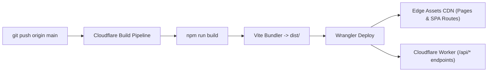

# J/Kopay Christian College — Official Digital Portal
### யா/ கோப்பாய் கிறிஸ்தவ கல்லூரி • Kopay, Jaffna, Sri Lanka

[](https://react.dev/)
[](https://vitejs.dev/)
[](https://tailwindcss.com/)
[](https://workers.cloudflare.com/)
[](LICENSE)

> **Motto:** *"Truth and Justice"* · **மகுடவாசகம்:** *“உண்மைக்கும் நேர்மைக்கும்”*  
> **Vision:** *"The Ideal School in Peninsula"* · **தூரநோக்கு:** *“குடாநாட்டின் முன்மாதிரிப் பாடசாலை”*  
> **Mission:** *"To foster self respect, values, character, patriotism and Social Justice to lead the school community towards the global frontiers in education and to work for the optimum use of all the available resources skills and abilities."*

The official, production-grade web portal for **J/Kopay Christian College** (Kopay, Jaffna, Sri Lanka). Engineered with modern web standards, high-performance responsive UI, bilingual typography, offline resilience, and edge deployment.

🌐 **Live Production Portal:** [https://jkcc.edu.lk/](https://jkcc.edu.lk/)

---

## 🏫 Campus Facilities & Infrastructure

J/Kopay Christian College offers comprehensive facilities supporting academic excellence, practical science education, technological literacy, and holistic extracurricular development:

### 🔬 Advanced Science Laboratories
* **Physics, Chemistry & Biology Labs:** Fully equipped specialized laboratory facilities dedicated to G.C.E. Advanced Level and Ordinary Level practical curricula.
* **Modern Apparatus & Experiment Stations:** Hands-on scientific instrumentation, optical microscopes, chemical preparation zones, and safety-compliant storage for practical examinations and STEM discovery.

### 💻 Computer & Information Technology Center
* **Networked Workstations:** Dedicated computer laboratory providing student access to modern computing hardware and digital educational software.
* **Broadband & ICT Literacy:** High-speed internet access for student research, ICT coursework, algorithmic thinking, and digital presentation development.

### 📚 College Library & Digital Learning Resource Center
* **Comprehensive Book Repository:** Extensive collection of educational volumes, curriculum guides, past examination archives, periodicals, and Tamil & English literature.
* **Reading & Study Stations:** Quiet, distraction-free study spaces designed for independent research, student collaborative study, and academic preparation.

### 🏛️ Bren Hall & Collegiate Assembly Auditorium
* **Main Assembly & Cultural Hall:** Multi-purpose collegiate hall serving as the ceremonial center for daily morning assemblies, prize givings, and religious services.
* **Acoustics & Stage Lighting:** Equipped for student drama, Tamil cultural showcases, debate competitions, and community educational forums.

### ⚽ Sports Grounds & Athletic Pavilion
* **Extensive Outdoor Athletic Grounds:** Multi-discipline sports field accommodating cricket, football, volleyball, netball, and track-and-field athletics.
* **Inter-House Athletic Meets:** Annual sports competitions fostering teamwork, physical fitness, discipline, and competitive spirit.

### 🏆 Collegiate House System
The student body is organized into four storied collegiate houses, fostering sportsmanship, camaraderie, and leadership:
* 🔴 **Fleming House**
* 🔵 **Bren House**
* 🟡 **Goodchild House**
* 🟢 **Peto House**

### 🤝 Clubs, Societies & Co-Curricular Organizations
* **Science & Innovation Club:** STEM workshops, scientific exhibitions, and quiz competitions.
* **Tamil Literary Association (தமிழ் மன்றம்):** Poetry recitations, oratorical competitions, and cultural celebrations.
* **English Literary & Debating Society:** Developing global communication skills, speechcraft, and debate.
* **Information & Communication Technology (ICT) Club:** Coding workshops, multimedia creation, and technology seminars.
* **Scout Troop & Cadet Movement:** Character formation, outdoor survival, discipline, and civic duty.
* **Environmental & Health Society:** Green campus initiatives, tree planting, and community health awareness.

---

## 🛠️ Technical Architecture & Specifications

### ⚡ Frontend Core
* **Framework:** [React 19](https://react.dev/) utilizing Concurrent Mode, functional components with custom hooks, and `useCallback`/`useMemo` optimization.
* **Build System & Toolchain:** [Vite 6](https://vitejs.dev/) with Rollup-based asset compilation, ESM HMR, and automated code chunking.
* **Client-Side Routing:** [React Router v7](https://reactrouter.com/) Single Page Application (SPA) architecture with lazy-loaded route views (`React.lazy` and `Suspense`).

### 🎨 Styling & Responsive Design System
* **CSS Framework:** [Tailwind CSS 3.4](https://tailwindcss.com/) with PostCSS and Autoprefixer.
* **Collegiate Color Tokens:**
  * Forest Green: `#196716` (`brand-forest`)
  * Forest Deep Hover: `#135211` (`brand-forestHover`)
  * Sage Green: `#588F54` (`brand-sage`)
  * Light Mint: `#E9F8E7` (`brand-light`)
  * Dark Canvas: `#0b120c` / `#111e13` (Adaptive dark mode support)
* **3D Perspective Transforms:** Hardware-accelerated CSS 3D transforms (`perspective`, `rotateY`, `backface-visibility: hidden`) powering the interactive Principles flip cards and the Coverflow 3D photo gallery.
* **Typography Engine:**
  * **Latin Script:** [Plus Jakarta Sans](https://fonts.google.com/specimen/Plus+Jakarta+Sans)
  * **Tamil Script:** [Noto Sans Tamil](https://fonts.google.com/specimen/Noto+Sans+Tamil)

### 📡 Offline Network Resiliency & Error Recovery
* **Real-Time Connectivity Monitoring:** Global event listeners (`online` / `offline`) integrated into application state.
* **Contextual In-Place Offline Fallback:** Custom `OfflineFallback` component with animated Wi-Fi diagnostics, server connection ping testing, and in-place retry capabilities without destroying the user's active route or URL state.
* **Network Error Boundary:** React Error Boundary wrapping lazy chunk imports to gracefully intercept network timeouts or chunk download failures on unstable connections.

### 🔍 Spotlight Command Palette (`Ctrl + K` / `/`)
* System-wide modal search indexed across portal pages, school events, leadership, facilities, and contact points.
* Micro-staggered CSS entry transitions with full keyboard accessibility (`↑↓` navigation, `↵` selection, `Esc` dismissal).

### 🖨️ A4 Full-Page Print Engine
* Ink-friendly, high-contrast `@media print` stylesheet optimized specifically for standard **A4 portrait sheets** ($190\text{mm} \times 270\text{mm}$ printable canvas).
* Features an ornate collegiate double-border, subtle crest watermark (`opacity: 0.045`), calibrated Tamil typography (`text-[13pt]`/`text-[12.5pt]` with `leading-[2.05]`), and page-break isolation to guarantee a pristine, zero-overflow single-page document.

### 🌐 Edge Deployment & Serverless Integration
* **Hosting Platform:** [Cloudflare Workers with Static Assets](https://developers.cloudflare.com/workers/static-assets/) providing global edge CDN delivery and instant asset caching.
* **Serverless Worker (`worker.js`):**
  * SPA route fallback routing for seamless deep linking.
  * API proxy dispatchers (`/api/github`, `/api/resolve-facebook`) with automated CORS handling and security headers (`X-Robots-Tag: noindex, nofollow, noarchive`).
  * 301 Permanent Canonical redirects for query parameter consolidation (`/?lang=...`).
* **Security & HTTP Headers:** Configured with `Strict-Transport-Security` (HSTS), `X-Frame-Options: SAMEORIGIN`, `X-Content-Type-Options: nosniff`, and `Referrer-Policy: strict-origin-when-cross-origin`.

### 🚀 Search Engine Optimization (SEO) & Performance
* **Dynamic Metadata:** Automated document title, meta description, and Open Graph / Twitter Card tag synchronization per route.
* **Sitemap & Search Console:** Fully structured XML Sitemap (`sitemap.xml`) indexing pages and campus imagery with Google Image protocol support.
* **Bidirectional Hreflang:** Dynamic `xhtml:link` annotations for English (`en`), Tamil (`ta`), and `x-default`.
* **Vendor Chunk Optimization:** Manual Rollup chunking separating React, React-DOM, and React Router from application code, slashing primary bundle size for sub-second First Contentful Paint (FCP).

---

## ⌨️ Global Keyboard Shortcuts

| Shortcut | Action | Scope |
| :--- | :--- | :--- |
| <kbd>Ctrl</kbd> + <kbd>K</kbd> / <kbd>⌘</kbd> + <kbd>K</kbd> | Toggle Spotlight Search Command Palette | Global |
| <kbd>/</kbd> | Open Search Palette (when outside form inputs) | Global |
| <kbd>Esc</kbd> | Close active dialog (Search, Anthem Modal, Mobile Menu) | Global |
| <kbd>↑</kbd> / <kbd>↓</kbd> | Navigate search results | Command Palette |
| <kbd>Enter</kbd> | Select active item / Flip Principles Card | Search / 3D Cards |
| <kbd>←</kbd> / <kbd>→</kbd> | Previous / Next slide | 3D Photo Gallery |

---

## 📁 Repository Directory Structure

```text
KCC-Project/
├── public/
│   ├── assets/                     # School crest, campus photography, and facility media
│   ├── _headers                    # Cloudflare edge security headers (HSTS, CSP, X-Frame)
│   ├── 404.html                    # Fallback redirect for static hosts
│   ├── robots.txt                  # Search crawler directives & sitemap location
│   └── sitemap.xml                 # XML Sitemap with image metadata & hreflang tags
├── src/
│   ├── components/
│   │   ├── AboutDropdown.jsx       # Navigation dropdown for school institutional links
│   │   ├── AnthemModal.jsx         # School anthem modal with integrated audio/lyrics
│   │   ├── AnthemPrintSheet.jsx    # Formal A4 full-page certificate print layout
│   │   ├── Contact.jsx             # Contact cards and message inquiry interface
│   │   ├── Footer.jsx              # Footer navigation, contacts, and copyright notices
│   │   ├── Gallery.jsx             # 3D Coverflow photo journal and campus gallery
│   │   ├── GlassImage.jsx          # Progressive image component with shimmer placeholder
│   │   ├── GlassSkeleton.jsx       # Route suspense shimmer skeleton loader
│   │   ├── Hero.jsx                # Campus hero section with bilingual banner
│   │   ├── HistoryTimeline.jsx     # Institutional milestones timeline
│   │   ├── LeadershipDirectory.jsx # Administration directory
│   │   ├── Navbar.jsx              # Responsive header, search launcher & mobile drawer
│   │   ├── NetworkErrorBoundary.jsx# Boundary catching chunk-load and network drops
│   │   ├── OfflineFallback.jsx     # In-place network diagnostics & reconnect tester
│   │   ├── Performance.jsx         # Animated counter statistics and metrics section
│   │   ├── Principles.jsx          # Interactive 3D flip cards for Motto, Vision, Mission
│   │   ├── SchoolAnthem.jsx        # School anthem player, Tamil lyrics, and print trigger
│   │   ├── SchoolEvents.jsx        # School events timeline & Facebook community sync
│   │   ├── SearchModal.jsx         # Spotlight command palette with staggered transitions
│   │   └── ThemeToggle.jsx         # Adaptive dark / light theme switcher
│   ├── context/
│   │   └── SiteContentContext.jsx  # Global site content state and CMS provider
│   ├── data/
│   │   ├── facebookEvents.js       # Facebook community feeds and fallback news data
│   │   └── siteContent.json        # Centralized site content repository
│   ├── pages/
│   │   ├── AdminPage.jsx           # Administrative portal for site updates
│   │   ├── AnthemPage.jsx          # Dedicated school anthem page
│   │   ├── ContactPage.jsx         # Contact administration view
│   │   ├── EventsPage.jsx          # School events & news gallery
│   │   ├── GalleryPage.jsx         # Photo journal view
│   │   ├── HistoryPage.jsx         # History and leadership view
│   │   ├── HomePage.jsx            # Main portal landing page
│   │   └── NotFoundPage.jsx        # 404 view with "Report Broken Link" mailto
│   ├── App.jsx                     # Root application router, SEO manager & network listener
│   ├── index.css                   # Custom utility classes, 3D keyframes & A4 print CSS
│   └── main.jsx                    # React 19 entry point
├── functions/
│   └── api/                        # Cloudflare Pages / Workers API functions
├── worker.js                       # Cloudflare Worker for edge routing & API dispatching
├── wrangler.json                   # Cloudflare Workers & Static Assets deployment configuration
├── index.html                      # HTML5 template, Open Graph meta, and JSON-LD schema
├── package.json                    # Project metadata, dependencies, and npm scripts
├── tailwind.config.js              # Tailwind theme configurations and color tokens
└── vite.config.js                  # Bundler configuration and manual chunk splitting
```

---

## 🚀 Getting Started

### Prerequisites
* [Node.js](https://nodejs.org/) (`v18.0.0` or higher recommended)
* [npm](https://www.npmjs.com/) (included with Node.js)

### Local Development Setup

1. **Clone the repository:**
   ```bash
   git clone https://github.com/Sivodayan/KCC-Project.git
   cd KCC-Project
   ```

2. **Install project dependencies:**
   ```bash
   npm install
   ```

3. **Launch the development server:**
   ```bash
   npm run dev
   ```
   The application will be live at `http://localhost:5173/`.

4. **Compile for production:**
   ```bash
   npm run build
   ```

5. **Preview production build locally:**
   ```bash
   npm run preview
   ```

---

## ☁️ Deployment Pipeline

The application is deployed on **Cloudflare Workers with Static Assets**:



* **Configuration:** [wrangler.json](file:///d:/Documents/Projects/HTML/KCC%20Project/wrangler.json)
* **Build Command:** `npm run build`
* **Static Assets Directory:** `./dist`
* **SPA Handling:** `not_found_handling: "single-page-application"`
* **Worker Execution:** `run_worker_first: ["/api/*"]`

---

## 📄 License

Distributed under the **MIT License**. See `LICENSE` for further details.

---

<div align="center">
  <sub>Official Digital Platform · <strong>J/Kopay Christian College</strong> · யா/ கோப்பாய் கிறிஸ்தவ கல்லூரி</sub>
</div>
