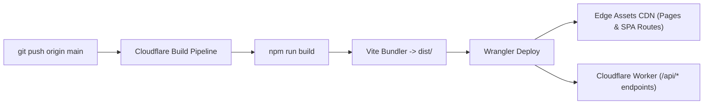

# J/Kopay Christian College - Official Web Platform
### Institutional Single Page Application (SPA)

[](https://react.dev/)
[](https://vitejs.dev/)
[](https://tailwindcss.com/)
[](https://reactrouter.com/)
[](https://workers.cloudflare.com/)
[](LICENSE)

The official web portal for **J/Kopay Christian College** (யா/ கோப்பாய் கிறிஸ்தவ கல்லூரி), Kopay, Jaffna, Sri Lanka. Built as a high-performance Single Page Application with **React 19**, **Vite 6**, and **Tailwind CSS**, featuring hardware-accelerated 3D components, dual-language state synchronization, an in-place offline resiliency system, an A4 certificate-grade print stylesheet, an administrative Git-backed CMS, and edge deployment on **Cloudflare Workers with Static Assets**.

🌐 **Production Website:** [https://jkcc.edu.lk/](https://jkcc.edu.lk/)

---

## 🌟 Application Features & Interactive Modules

### 🔍 Spotlight Command Palette (`Ctrl + K` / `/`)
* **Global Keyboard Launcher:** Activated anywhere with <kbd>Ctrl</kbd> + <kbd>K</kbd> (or <kbd>⌘</kbd> + <kbd>K</kbd>), or <kbd>/</kbd> when not focused inside a form input.
* **Instant Client-Side Filtering:** Rapid indexed search across portal pages, event archives, photo galleries, anthem, history, and contact directory.
* **Staggered Micro-Animations:** CSS entry transitions with keyboard navigation support (<kbd>↑</kbd>/<kbd>↓</kbd> highlight, <kbd>Enter</kbd> navigate, <kbd>Esc</kbd> dismiss).
* **Direct Category Filters:** One-click filter pills for *Events*, *History*, *Gallery*, *Heritage*, and *Social*.

### 🃏 3D Perspective Principles Flip Cards
* **Hardware-Accelerated 3D Transform:** Implemented with CSS `perspective: 1000px`, `transform-style: preserve-3d`, and `backface-visibility: hidden` for smooth 60fps card rotations.
* **Bilingual Flip State:** Flips smoothly between English and Tamil (*Motto*, *Vision*, *Mission*) on hover, tap, or keyboard focus (<kbd>Enter</kbd> / <kbd>Space</kbd>).
* **Viewport Reveal:** Triggered via `IntersectionObserver` with staggered entrance animation once scrolled into view.

### 🖼️ 3D Coverflow Photo Journal & Campus Gallery
* **Perspective 3D Carousel:** Custom multi-angle coverflow displaying campus life and school milestones.
* **Multi-Input Navigation:** Supports touch swipe gestures, mouse click on side cards, mouse wheel scrolling, indicator pills, navigation arrows, and continuous auto-advance timer.
* **Progressive Image Loading:** Integrated `GlassImage` with shimmer skeleton placeholders (`GlassSkeleton`) and automatic fallback resolution.

### 📜 School Anthem Dialog & Tamil Lyrics
* **Modal Dialog & Dedicated Page:** Available both as a quick-access modal dialog and as a dedicated route (`/anthem`).
* **Tamil Script Presentation:** Rendered in *Noto Sans Tamil* in *Ragam Hamsadhwani* with verse structure breakdown.
* **Clipboard Copy Utility:** One-click copy action with temporary visual confirmation tooltip.
* **Print Trigger:** Direct action button launching the browser print dialog targeting the specialized A4 print engine.

### 🖨️ A4 Full-Page Ink-Friendly Print Engine
* **Calibrated A4 Dimensions:** Custom `@media print` rules tailored to standard **$190\text{mm} \times 270\text{mm}$** printable portrait area, strictly preventing multi-page overflow.
* **Certificate-Grade Framing:** Formal collegiate double-line border, subtle corner emblems (`❖`), central crest watermark (`opacity: 0.045`), and uniform typography (`text-[13pt] font-medium text-slate-900`) across all 19 verse lines.
* **Eco-Friendly Output:** Strips UI chrome, navigation bars, modal backgrounds, and dark mode overrides for ink-efficient printing.

### 📈 Interactive Performance & Statistics Counters
* **Scroll-Triggered Easing Animations:** Animated numeric counters powered by an `easeOutExpo` easing function running through `requestAnimationFrame`.
* **Dynamic Content Sync:** Pulls statistical metrics (founding year, student enrollment, faculty count, G.C.E. O/L pass rates, G.C.E. A/L qualification rates, active clubs, houses) dynamically from the centralized content store.

### 📰 School Events & Facebook Community Integration
* **Embedded Facebook Newsfeed:** Synchronized with the official school Facebook community page with iframe sandbox security.
* **Interactive Spotlight Cards:** Mouse-tracking gradient spotlight effects on hover (`onMouseMove`), responsive glassmorphic skeleton loaders, and fallback link handling.
* **Canonical URL Resolver:** Backend API integration that resolves short Facebook mobile share URLs into permanent post permalinks.

### 📡 Offline Network Resiliency & Error Recovery
* **Real-Time Connectivity Listeners:** Global event listeners on `window.addEventListener('online')` and `'offline'`.
* **Contextual Offline Banner:** Surfaces a non-blocking amber sticky alert when internet connection drops, switching to an auto-dismissing emerald green badge upon reconnection.
* **Network Error Boundary:** Custom React boundary (`NetworkErrorBoundary`) wrapping lazy route imports to catch chunk loading failures, displaying an in-place `OfflineFallback` with a live server ping tester (*"Try Again"*) without resetting the user's route history or URL bar.

### 🌐 Dual-Language State Synchronization & SEO
* **URL-Synchronized Language Switching:** History records toggle between English and Tamil (தமிழ்) with URL state sync (`/history?lang=ta`).
* **Bidirectional Hreflang Tags:** Dynamically maintains `<link rel="alternate" hreflang="...">` tags for `en`, `ta`, and `x-default`.
* **Dynamic Metadata Injection:** Synchronizes page titles, meta descriptions, Open Graph, and Twitter Card attributes per route change.

### 🌓 Adaptive Dark / Light Theming
* **Tailwind CSS Theme Engine:** Class-based theme toggling with instant root class switching (`html.dark`).
* **Persistent Preferences:** Automatically detects system color scheme (`prefers-color-scheme`) and persists user preference in `localStorage`.

### 🚫 Themed Institutional 404 Page
* **Institutional Error Page:** Custom collegiate error view styled with school branding, background watermark crest, bilingual messaging in English and Tamil, and direct navigation links back to the home portal.

### 🔐 Administrative Portal & Git-Backed CMS (`/admin`)
* **Firebase Authentication:** Secure administrator sign-in supporting Google OAuth popup and Email/Password credentials with password reset capabilities.
* **Inactivity Session Lock:** Automatic session timeout after 15 minutes of inactivity for security.
* **Direct GitHub Git-Sync:** Commits content updates directly to the GitHub repository via Cloudflare Worker API (`/api/github`), maintaining full version history without a SQL database.
* **Undo / Redo History Stack:** Client-side undo/redo state management for all content editing forms.
* **Client-Side Image Processing:** Built-in canvas compression and validation resizing images to max $1920 \times 1280$ at $0.88$ quality before commit.

---

## 🛠️ Technical Stack & Toolchain

| Layer | Technologies / Tools | Description |
| :--- | :--- | :--- |
| **Frontend Framework** | [React 19](https://react.dev/) | Functional components, custom hooks, `React.lazy`, `Suspense` |
| **Client-Side Router** | [React Router v7](https://reactrouter.com/) | SPA route management, query param sync, in-place error boundaries |
| **Build Tool & Bundler** | [Vite 6](https://vitejs.dev/) | Rollup bundling, ESM Hot Module Replacement (HMR), manual chunking |
| **CSS Framework** | [Tailwind CSS 3.4](https://tailwindcss.com/) | Utility-first CSS, custom brand color tokens, 3D transform utilities |
| **Authentication** | [Firebase Auth](https://firebase.google.com/) | Google OAuth & Email/Password administrative authentication |
| **Edge Hosting** | [Cloudflare Workers](https://workers.cloudflare.com/) | Edge CDN, Static Assets, serverless functions, SPA fallback |
| **Fonts** | Google Fonts | [Plus Jakarta Sans](https://fonts.google.com/specimen/Plus+Jakarta+Sans) (Latin), [Noto Sans Tamil](https://fonts.google.com/specimen/Noto+Sans+Tamil) (Tamil) |

---

## ⌨️ Keyboard Navigation Shortcuts

| Shortcut | Action | Scope |
| :--- | :--- | :--- |
| <kbd>Ctrl</kbd> + <kbd>K</kbd> / <kbd>⌘</kbd> + <kbd>K</kbd> | Toggle Search Command Palette | Global |
| <kbd>/</kbd> | Open Search Palette (when outside text inputs) | Global |
| <kbd>Esc</kbd> | Close active dialog (Search, Anthem, Mobile Drawer) | Global |
| <kbd>↑</kbd> / <kbd>↓</kbd> | Navigate search results | Command Palette |
| <kbd>Enter</kbd> | Select search item / Flip 3D Principles card | Search / 3D Cards |
| <kbd>←</kbd> / <kbd>→</kbd> | Previous / Next slide | 3D Photo Gallery |

---

## 📁 Repository Directory Structure

```text
KCC-Project/
├── public/
│   ├── assets/                     # Campus photography, logos, and event imagery
│   ├── _headers                    # Cloudflare edge security headers (HSTS, CSP, X-Frame)
│   ├── 404.html                    # Fallback redirect for static hosts
│   ├── robots.txt                  # Search engine crawler directives & sitemap location
│   └── sitemap.xml                 # XML Sitemap with Google Image extensions & hreflang
├── src/
│   ├── components/
│   │   ├── AboutDropdown.jsx       # Navigation dropdown for institutional links
│   │   ├── AnthemModal.jsx         # School anthem dialog with Tamil lyrics & print trigger
│   │   ├── AnthemPrintSheet.jsx    # Formal A4 full-page certificate print layout
│   │   ├── Contact.jsx             # Contact cards and message inquiry interface
│   │   ├── Footer.jsx              # Footer navigation, contacts, and copyright notices
│   │   ├── Gallery.jsx             # 3D Coverflow photo journal and campus gallery
│   │   ├── GlassImage.jsx          # Progressive image component with shimmer placeholder
│   │   ├── GlassSkeleton.jsx       # Route suspense shimmer skeleton loader
│   │   ├── Hero.jsx                # Campus hero section with bilingual banner
│   │   ├── HistoryTimeline.jsx     # Institutional milestones timeline
│   │   ├── LeadershipDirectory.jsx # Administration directory
│   │   ├── Navbar.jsx              # Responsive header, search launcher & mobile drawer
│   │   ├── NetworkErrorBoundary.jsx# Boundary catching chunk-load and network drops
│   │   ├── OfflineFallback.jsx     # In-place network diagnostics & reconnect tester
│   │   ├── Performance.jsx         # Animated counter statistics and metrics section
│   │   ├── Principles.jsx          # Interactive 3D flip cards for Motto, Vision, Mission
│   │   ├── SchoolAnthem.jsx        # School anthem page, Tamil lyrics, and print trigger
│   │   ├── SchoolEvents.jsx        # School events timeline & Facebook community sync
│   │   ├── SearchModal.jsx         # Spotlight command palette with staggered transitions
│   │   └── ThemeToggle.jsx         # Adaptive dark / light theme switcher
│   ├── context/
│   │   └── SiteContentContext.jsx  # Global site content state and CMS provider
│   ├── data/
│   │   ├── facebookEvents.js       # Facebook community feeds and fallback news data
│   │   └── siteContent.json        # Centralized site content repository
│   ├── pages/
│   │   ├── AdminPage.jsx           # Administrative portal for site updates
│   │   ├── AnthemPage.jsx          # Dedicated school anthem page
│   │   ├── ContactPage.jsx         # Contact administration view
│   │   ├── EventsPage.jsx          # School events & news gallery
│   │   ├── GalleryPage.jsx         # Photo journal view
│   │   ├── HistoryPage.jsx         # History and leadership view
│   │   ├── HomePage.jsx            # Main portal landing page
│   │   └── NotFoundPage.jsx        # Custom institutional 404 error view with home navigation
│   ├── utils/
│   │   ├── githubSync.js           # GitHub REST API commit & token verification helpers
│   │   └── imageUpload.js          # Canvas image compression, resizing, and MIME validation
│   ├── firebase.js                 # Firebase initialization and authentication methods
│   ├── App.jsx                     # Root application router, SEO manager & network listener
│   ├── index.css                   # Custom utility classes, 3D keyframes & A4 print CSS
│   └── main.jsx                    # React 19 entry point
├── functions/
│   └── api/                        # Cloudflare Pages / Workers API functions
├── worker.js                       # Cloudflare Worker for edge routing & API dispatching
├── wrangler.json                   # Cloudflare Workers & Static Assets deployment configuration
├── index.html                      # HTML5 template, Open Graph meta, and JSON-LD schema
├── package.json                    # Project metadata, dependencies, and npm scripts
├── tailwind.config.js              # Tailwind theme configurations and color tokens
└── vite.config.js                  # Bundler configuration and manual chunk splitting
```

---

## 🚀 Local Development Setup

### Prerequisites
* [Node.js](https://nodejs.org/) (`v18.0.0` or higher recommended)
* [npm](https://www.npmjs.com/) (bundled with Node.js)

### Installation & Run

1. **Clone the repository:**
   ```bash
   git clone https://github.com/Sivodayan/KCC-Project.git
   cd KCC-Project
   ```

2. **Install project dependencies:**
   ```bash
   npm install
   ```

3. **Start local development server:**
   ```bash
   npm run dev
   ```
   Access the local server at `http://localhost:5173/`.

4. **Compile production build:**
   ```bash
   npm run build
   ```

5. **Preview production build locally:**
   ```bash
   npm run preview
   ```

---

## ☁️ Deployment Pipeline

The application is deployed on **Cloudflare Workers with Static Assets**:



* **Configuration:** [wrangler.json](file:///d:/Documents/Projects/HTML/KCC%20Project/wrangler.json)
* **Build Command:** `npm run build`
* **Static Assets Directory:** `./dist`
* **SPA Handling:** `not_found_handling: "single-page-application"`
* **Worker Execution:** `run_worker_first: ["/api/*"]`

---

## 📄 License & Ownership

**Proprietary Software - All Rights Reserved.**  
Copyright © 2026 **Sivodayan Sujeevakumar**.

This software and all associated source code, design assets, and documentation are strictly the private and proprietary property of Sivodayan Sujeevakumar. Unauthorized copying, modification, distribution, sublicensing, reverse engineering, or commercial use without prior written permission is strictly prohibited. See [LICENSE](LICENSE) for full legal terms.

---

<div align="center">
  <sub>J/Kopay Christian College Web Portal · Built with React 19, Vite & Cloudflare Workers</sub>
</div>
